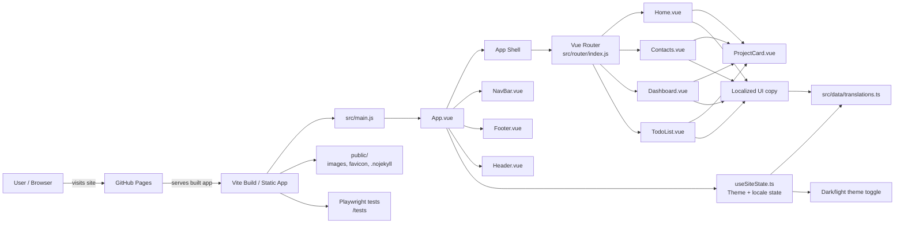

# Architecture Overview

This Vue portfolio app is a client-side Vite application with a routed page shell, reusable UI components, localized content, and static public assets.

## Key architectural layers

- Entry layer: `src/main.js` boots the Vue app and installs the router.
- Shell layer: `src/App.vue` renders the global layout and hosts `router-view`.
- Routing layer: `src/router/index.js` maps routes to the main pages.
- Page layer: `src/pages/*.vue` contains page-specific sections for the portfolio experience.
- Component layer: `src/components/*.vue` contains reusable UI elements such as navigation, footer, and project cards.
- State and content layer: `src/composables/useSiteState.ts` manages theme and locale state, while `src/data/translations.ts` provides localized text.
- Static assets layer: `public/` holds favicon, images, and deployment-related assets.
- Delivery layer: Vite builds the client app and GitHub Pages serves the deployed site.
